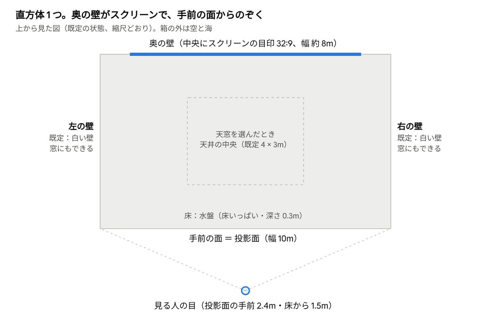

# room モードの空間（箱）の仕様

（2026-10-26）

room モードの空間は、幅 10m・奥行き 6m・高さ 3.2m の直方体 1 つ。6 つの面それぞれを、壁・窓（穴）・一枚ガラスのどれかにでき、その外には空と海がある。この箱の構造を別の人に考えてもらうための前提をまとめる。計算の中身は [`docs/room.md`](room.md)。

## 全体図（上から見た図、既定の状態）

既定では窓はなく、左右の壁・天井とも白い壁。左右の壁は窓（壁いっぱい）に、天井は天井いっぱいの窓か、中央の点線の所だけの天窓にできる。

## 寸法と向き

箱は、傾きや段差のない直方体 1 つ。寸法はパネルで変えられる（下の表は今保存している値）。

| 項目 | 今の値 | 決まり |
|---|---|---|
| 幅（左右） | 10 m | 自由に変えられる |
| 奥行き（手前→奥） | 6 m | 自由に変えられる |
| 高さ（床→天井） | 3.2 m | 自由に変えられる |
| 壁の厚さ | 0 | 面は厚みのない板。柱・梁・窓枠もない |

- 向き：**奥の壁がスクリーンの面**で、見る人はそれを正面に見る。右・左は見る人から見た右・左
- 方位：奥の壁が向く方位は、場所の設定（スクリーンの向き）で決まる。日差しの向きは日時と緯度経度から計算する
- 座標（計算の中）：左右が x（−5〜+5m）、上下が y（床 0〜天井 3.2m）、奥行きが z（手前 0〜奥 −6m）

## 6 つの面

床をのぞく 5 つの面は、それぞれ「白い壁」「窓（穴）」「一枚ガラス」のどれかにできる。床は、いつも白い床か水盤。

| 面 | 白い壁 | 窓（穴） | 一枚ガラス | 今の既定 |
|---|---|---|---|---|
| 右の壁 | ◯ | ◯ 壁いっぱい | ◯ | 壁 |
| 左の壁 | ◯ | ◯ 壁いっぱい | ◯ | 壁 |
| 天井 | ◯ | ◯ 天井いっぱい、または天窓（中央に一部） | ◯（天窓のまわりだけも可） | 壁 |
| 奥の壁（スクリーン） | ◯ | × | ◯ | 壁 |
| 手前の壁（見る人の側） | ◯ | × | ◯ | 壁 |
| 床 | ◯ | × | × | 水盤（床いっぱい） |

- 窓とガラスを同じ面に重ねると、窓の所は穴のままで、残りがガラスになる
- 既定は窓もガラスもない、完全に閉じた箱。このままでは日差し・月明かり・空の光は入らず、夜の照明だけで照らす
- 手前の壁は計算上あるが、視点が箱の外にあるときは描かず、中をのぞいて見える

## 窓（開口）

窓は「左の壁」「右の壁」「天井」を組み合わせて選ぶ。壁の窓は壁いっぱいの穴で、枠もガラスもない。

| 窓 | 大きさ | 位置 |
|---|---|---|
| 左の壁 | 壁いっぱい（奥行き 6m × 床から天井 3.2m） | 壁全体 |
| 右の壁 | 壁いっぱい（同上） | 壁全体 |
| 天井：天井いっぱい | 10m × 6m | 天井全体 |
| 天井：天窓 | 幅と奥行きを変えられる（既定 4m × 3m） | 天井の中央。位置は動かせない |

- 左と右は、両方同時に開けられる。天井は「なし・天井いっぱい・天窓」のどれか 1 つ
- 奥の壁と手前の壁には、窓（穴）は開けられない（ガラスにはできる）
- 壁の一部だけの窓（腰窓など）は、今は使っていない。前の作りでは、壁の中央に 1 つ、幅・高さ・床からの高さを決めて開けられた。必要なら戻せる
- 光が入るかどうかは、太陽が窓の外側にあるかで決まる。壁の窓は太陽の方位と高さ、天井の窓は太陽の高さだけで決まる

## ガラスの面

ガラスは、面ごとに「面全体が枠なしの一枚ガラス」になる。仕様は面ごとに別々に決められる。

| 項目 | 選べるもの | 既定 |
|---|---|---|
| 種類 | 高透過（低鉄、ほぼ無色、約 99%）・普通の板ガラス（わずかに緑、約 94〜97%）・色付き（色を選ぶ） | 高透過 |
| 透過率 | 倍率で下げられる | 1 |
| 表面の形 | 平ら・波打ち・うねり・リブ（縦の筋） | 平ら |
| 模様の大きさ | m 単位 | 0.15 m |
| 表面の深さ | mm 単位 | 0.8 mm |
| 虹（プリズム） | オン・オフと強さ | オフ |

- 屈折率は 1.5。映り込みは真正面で約 4%、斜めに見るほど強くなる
- 板の厚さは計算していない。平らなガラスでは、景色のずれは描かない
- 表面に凹凸があると、通った日差しが床や壁に光の網目として落ちる
- ガラスの外は、窓の外と同じ空と海。奥の壁をガラスにすると、スクリーンの目印は消える
- すりガラスはまだない

## 床・素材・スクリーンの目印

床は既定で、床いっぱいの浅い水盤。水面の高さが床の高さ（0m）で、底はその下にある（床に掘り込んだ形）。

| もの | 今の仕様 |
|---|---|
| 水盤 | 床全体。深さ 0.3m（0.02〜1.5m で変えられる）。波の強さ 0.3。オフにするとただの床 |
| 壁・天井 | 白い塗装。光を全方向に均等に返す（つやなし）、反射率 0.82 |
| 床（水盤の底も） | つやなし、反射率 0.72 |
| スクリーンの目印 | 奥の壁の中央。32:9、幅 約 7.96m × 高さ 約 2.24m、床から 約 0.38〜2.62m。つやなしの灰色、反射率 0.45 |

- スクリーンの目印の大きさは、部屋の寸法から自動で決めている（幅は部屋の幅の 80% まで、高さは部屋の 70% まで）。投影面の実寸はまだ測っていない
- 素材はこの 3 種類とガラスだけ。木や金属、面ごとに違う色は、今は選べない

## 箱の外（空・海）と光

箱の外には建物も地面もなく、空と、水平線まで続く海だけがある。光は、窓とガラスの面からだけ入る。

- 海面は床より 1m 下。風速 6m/s 相当の波が立つ。海をオフにすると外は地面になる
- 日差し：太陽の位置を、日時と緯度経度から計算する。太陽の大きさも入れているので、影の縁はぼける
- 月明かり：本物の月の位置から入る。明るさは満月
- 空の光：窓やガラスから見える空全体が、やわらかい光として入る
- 照り返し：壁・床・天井で跳ね返った光も、最大 3 回まで計算する。窓が大きいほど、部屋全体が明るくなる
- 窓の外の雲と、雲の影も出せる（今はオフ）

## 夜の照明

太陽の高さが 5° より低くなると点き始め、−4° で最も明るくなる。既定は「全体照明」で、「スポットライト」に切り替えられる。

| 照明 | 場所と形 | 既定の値 |
|---|---|---|
| 全体照明（既定） | 天井の端から 0.5m 内側の長方形が、むらなく光る面になる | 4000K |
| スポットライト | 1〜4 台（既定 3 台）。手前の端から 0.6m、天井から 0.15m 下。中央・左 2.5m・右 2.5m | 光の広がり 60°、真下から奥へ 35° 傾ける、9000K |

- 天窓の所は窓なので、全体照明の光る面は見えない。天井が窓やガラスのときも、部屋は同じように照らされる
- ライトの器具そのものは、既定では描いていない。照明をどこに付けるかは、構造と一緒に決める必要がある

## 見る人の位置と投影面

映像は、箱の手前の面を「のぞき窓」にして、その前に立つ人の目から見た絵。投影面の大きさと目の位置を実寸で入れると、現地の空間とつながって見えるようになる。

| 項目 | 今の値 |
|---|---|
| 投影面の幅 | 10 m（箱の幅と同じ） |
| 投影面の高さ | 幅と出す画面の縦横比（3840×1080、32:9）から決める |
| 投影面の下端 | 床から 約 0.09 m |
| 投影面の位置 | 箱の手前の端、左右は中央、傾きなし |
| 目の位置 | 投影面から手前に 2.4 m、床から 1.5 m、左右は中央 |

- 今はマウスで自由に動かす視点にしている。現地では、上の値で固定した視点にする
- 現地の投影面と、見る人の立つ位置は、まだ測っていない

## 今の計算でできないこと

今の計算は「直方体 1 つと、その面に開けた穴」だけを扱う。下のものは作れるが、計算に足す作業が要り、その分だけ描くのが重くなる。

| やりたいこと | 今 | 足すときの重さ |
|---|---|---|
| L 字・斜めの壁・勾配天井・段差 | × | 大きい（形の計算を作り直す） |
| 柱・梁・壁の厚み | × | 中（箱を足すごとに少しずつ重くなる） |
| 窓枠・サッシ・ガラスの継ぎ目 | × | 小〜中 |
| 壁の一部だけの窓、窓を複数 | 壁いっぱいのみ。天窓は中央に 1 つ | 小（前の作りでは、壁に 1 つ大きさを決めて開けられた） |
| 奥・手前の壁の窓（穴） | ×（ガラスは可） | 小 |
| 家具・仕切り・台 | × | 中 |
| つやのある床や壁、木や金属 | ×（つやなしの 3 種類とガラス） | 中 |
| 箱の外の建物・バルコニー・木 | ×（空と海だけ） | 中〜大きい |
| すりガラス | × | 中 |

今の重さは、Apple M4 で 1 フレーム約 6〜9ms。形を複雑にする場合は、どれを入れるかを先に決める。
